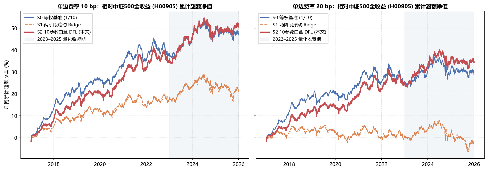
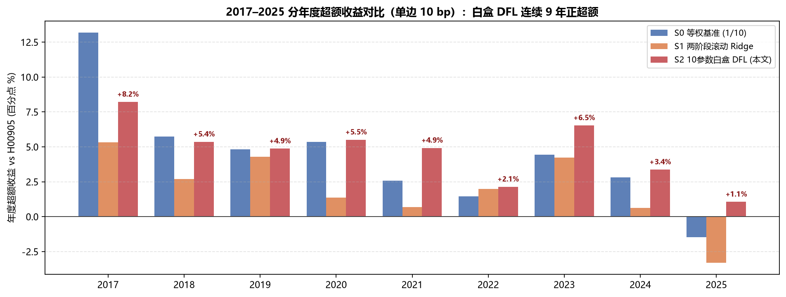
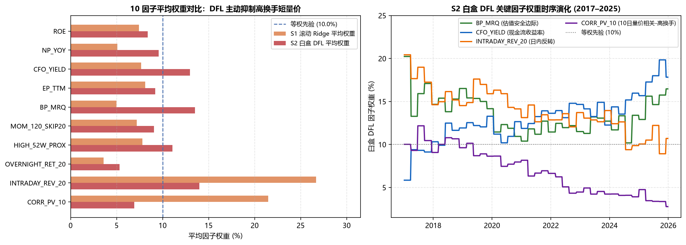

# CSI-DFL：基于 10 参数白盒决策聚焦学习（Whitebox DFL）的中证 500 指数增强研究

简洁、完全白盒、严格防未来函数与防幸存者偏差的 **中证 500（`000905` / 全收益基准 `H00905`）指数增强** 实证框架（`2014–2025`）。

---

## 一、研究核心思想

传统量化选股多采用 **“两阶段法（Predict-then-Optimize）”**：第一阶段用回归或机器学习最大化个股未来收益预测相关性，第二阶段再送入组合优化器满足风控约束。然而两阶段目标割裂会导致模型**盲目重仓短周期高换手量价信号**，在真实交易成本与行业/市值中性约束下严重损耗净值。

本项目提出并验证了一个**零黑盒、仅含 10 个可学习参数的白盒端到端决策聚焦学习（Whitebox Decision-Focused Learning, DFL）模型**：
1. **10 个经济学先验白盒因子**：覆盖质量成长（`ROE`、`NP_YOY`、`CFO_YIELD`）、传统估值（`EP_TTM`、`BP_MRQ`）、中期趋势（`MOM_120_SKIP20`、`HIGH_52W_PROX`）与行为量价（`OVERNIGHT_RET_20`、`INTRADAY_REV_20`、`CORR_PV_10`），每周截面严格对 **申万一级行业哑变量 + 对数流通市值** 做双 OLS 中性化。
2. **可微 Dykstra 风控投影层**：在纯 PyTorch 中展开交替投影算子，强制满足仅做多满仓、个股上限 `4.0%`、个股主动偏离 `±1.5%`、申万一级行业中性、Beta 中性与对数市值中性。
3. **直接优化扣费净 IR + 等权先验锚定**：10 个非负归一权重 $\theta = \text{softmax}(\text{logits})$ 直接最大化组合扣费净信息比率（训练费率 `15 bp`），并引入 $\lambda_{\text{prior}} \|\theta - 0.10\|_2^2$ 正则项防止相对 `1/N` 等权退化。

---

## 二、核心实证结果（2017–2025 严格周度 PIT 样本外滚动）

严格锁定 [事前研究宪章 `docs/PRE_ANALYSIS_PLAN.md`](docs/PRE_ANALYSIS_PLAN.md)，在运行任何回测前固定全部参数，仅评估精确 $N = 3$ 个递进模型（未读取 `2026+` 保留期数据）：

| 单边费率 | 策略 | 累计净收益 | vs H00905 超额 | 跟踪误差 TE | IR (H00905) | NW t-stat ($p$) | DSR ($N=3$) | 周双边换手 |
|---:|---|---:|---:|---:|---:|---:|---:|---:|
| **10 bp** | `S0_EqualWeight` | +99.32% | +63.63% | 4.01% | +1.032 | +2.76 (0.0057) | 98.06% | 31.10% |
| **10 bp** | `S1_RollingRidge` | +63.99% | +28.29% | 4.50% | +0.400 | +1.17 (0.2428) | 58.96% | 53.57% |
| **10 bp** | **`S2_WhiteboxDFL`** | **+104.27%** | **+68.58%** | **4.08%** | **+1.079** | **+2.93 (0.0034)** | **98.61%** | **27.85%** |
| **20 bp** | `S0_EqualWeight` | +74.83% | +39.13% | 4.10% | +0.635 | +1.72 (0.0863) | 71.99% | 30.42% |
| **20 bp** | `S1_RollingRidge` | +30.40% | -5.29% | 4.78% | -0.188 | -0.55 (0.5837) | 3.31% | 51.73% |
| **20 bp** | **`S2_WhiteboxDFL`** | **+82.39%** | **+46.69%** | **4.13%** | **+0.748** | **+2.05 (0.0401)** | **81.95%** | **27.33%** |

### 1. 累计超额净值曲线（10 bp & 20 bp）


### 2. 2017–2025 连续 9 年正超额（10 bp 口径）


### 3. 白盒机制：自动降权高换手量价、增配基本面现金流与估值


---

## 三、仓库目录结构

```text
CSI-DFL/
├── configs/experiment.toml          # 事前锁定的全部因子、模型、风控与交易参数
├── docs/
│   ├── PRE_ANALYSIS_PLAN.md         # 事前研究宪章（假设、样本切分与检验协议）
│   └── DEFENSE_GUIDE.md             # 答辩汇报逐页讲稿与高频老师提问 Q&A
├── src/csi500_alpha/
│   ├── fetch_csi500.py              # BaoStock 周度 PIT 成分/日线/估值采集与一致性校验
│   ├── factors.py                   # 10 因子工程、季报与行业 PIT 对齐、双 OLS 中性化
│   ├── projection.py                # 纯 PyTorch & NumPy 可微 Dykstra 风控投影层
│   ├── models.py                    # S0 等权、S1 滚动 Ridge、S2 10参数白盒 DFL
│   ├── backtest.py                  # 次日开盘撮合、整手取整、涨跌停/停牌拦截、hfq 连续净值
│   └── stats.py                     # Newey-West t 检验、PSR/DSR (N=3)、CSCV PBO
├── scripts/
│   ├── 01_fetch_csi500_data.py      # 第一步：原始行情、估值与周度历史成分采集
│   ├── 02_build_dataset.py          # 第二步：10 因子面板构建与无收益质量审计
│   ├── 03_run_dev_experiments.py    # 第三步：三模型滚动训练预测与双费率回测
│   ├── 04_run_stats_and_report.py   # 第四步：统计显著性检验与 DEV_REPORT.md 生成
│   └── 05_plot_defense_figures.py   # 第五步：生成答辩与报告可视化图表
├── tests/test_whitebox_dfl.py       # 7 项离线单元测试（投影约束、梯度、PIT、拆股连续性等）
└── reports/                         # 完整实验审计表、DEV_REPORT.md 及可视化图表
```

---

## 四、复现与测试指南

```powershell
# 1. 运行全部离线单元测试（无需联网）
python -B -m unittest discover -s tests -v

# 2. 采集数据（需联网访问 AKShare 与 BaoStock，并在 configs/experiment.toml 配置季报与申万一级行业路径）
python -B .\scripts\01_fetch_csi500_data.py --probe
python -B .\scripts\01_fetch_csi500_data.py --step all

# 3. 依次构建面板、运行三模型回测、输出统计审计与图表
python -B .\scripts\02_build_dataset.py
python -B .\scripts\03_run_dev_experiments.py
python -B .\scripts\04_run_stats_and_report.py
python -B .\scripts\05_plot_defense_figures.py
```

详细汇报讲稿与答辩问答请参阅：[docs/DEFENSE_GUIDE.md](docs/DEFENSE_GUIDE.md) 与 [reports/DEV_REPORT.md](reports/DEV_REPORT.md)。
