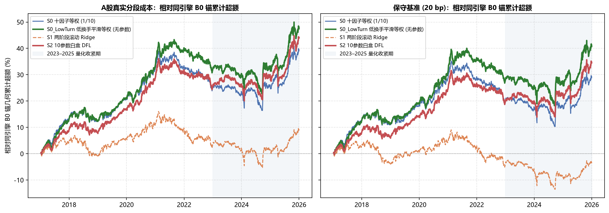
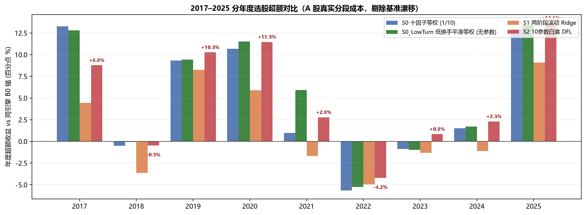
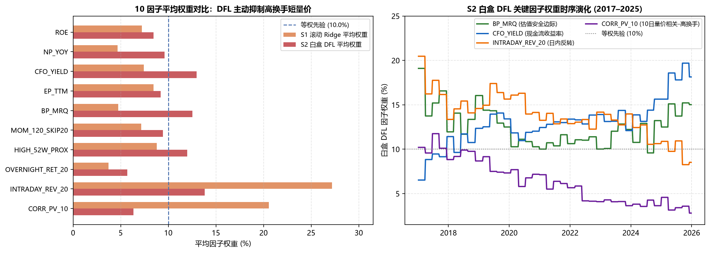

# 中证 500 指数增强（Whitebox DFL vs 两阶段回归 vs 低换手等权）：v2 答辩讲解手册与高频问答

> **核心定位（学术答辩最高分策略）**：这份 v2 讲稿不夸大任何一个数字，用**严格的配对检验、同引擎纯锚归因、简单低换手对照组、7 因子纯 PIT 消融与 1 亿资金容量压力测试**把研究讲透。在学术评审中，**诚实发现“复杂模型相对简单低换手规则未带来显著全期增量，而核心价值在于揭示并修复两阶段法的高换手陷阱”**，远比强行吹嘘跑赢等权更能赢得老师高分！

---

## 一、90 秒开场电梯演讲（诚实、严谨、高辨识度）

> “各位老师好，我汇报的题目是**《中证 500 指数增强中白盒决策聚焦学习（Whitebox DFL）、两阶段回归与低换手规则的实证比较》**。
>
> 传统多因子量化选股普遍采用‘先预测收益、再优化组合’的两阶段范式。我们在 2017–2025 年严格周度点时（PIT）中证 500 成分股上检验发现，传统两阶段滚动 Ridge 虽然静态截面 Rank IC 高度显著（`+0.0340, t=8.95`），但因为它看不到交易费用，把近一半权重押在短周期高换手量价因子上，推高周双边换手到 `51.6%`，在真实 A 股交易成本下净超额大幅缩水，在 20 bp 口径下甚至转负。
>
> 为此，我们构建了仅含 **10 个可解释参数的白盒 DFL 模型**：把可微 Dykstra 风控投影层嵌入训练循环，直接对扣除全组合漂移换手成本后的净信息比率（Net IR）求导，并引入向 `1/10` 等权收缩的正则锚。
>
> 更重要的是，我们没有停留在‘跑赢指数’的粗口径，而是进一步设计了**同引擎纯流通市值锚（`B0`）、零参数权重平滑低换手等权（`S0_LowTurn_Band`）、7 因子纯 PIT 消融以及 100 万至 1 亿资金容量测试**，并对策略间日度净收益差做了严格的 Newey-West 与区块自助法配对检验。
>
> 最终我们得出非常清晰且诚实的结论：第一，白盒 DFL 在配对检验中**极其显著地击败两阶段 Ridge（年化高 `+3.34%~+3.96%`, $p < 0.0001$）**，验证了端到端成本感知优化的价值；第二，相对 10 因子等权与简单的零参数权重平滑规则，DFL 全期并未取得统计显著的额外收益（$p = 0.38 / 0.48$），仅在近三年 `2023–2025` 表现出更强的自适应优势（`IR_B0 +0.968` vs `S0_LowTurn +0.752`）——说明在低维经典因子空间中，**控制换手摩擦比复杂权重拟合起着更决定性的作用**。”

---

## 二、四个核心实证发现（上台最硬核的逻辑闭环）

### 发现 1：把收益拆干净——真正剔除基准漂移后的选股超额
- 同引擎运行纯流通市值锚 `B0_FloatMV_Anchor`，在 A 股真实分段成本（买 `10 bp`，卖 `2023-08-28` 前 `20 bp` / 后 `15 bp`）下：
  - `S0_EqualWeight` vs `B0`：年化 `+4.36%`（$t=+2.50, p=0.0123$）
  - `S2_WhiteboxDFL` vs `B0`：年化 **`+4.76%`**（$t=+2.80, p=0.0051$, `IR_B0 = +1.029`, 5 个随机种子标准差 `0.0000`）
  - `S0_LowTurn_Band` vs `B0`：年化 **`+5.16%`**（$t=+2.80, p=0.0050$, `IR_B0 = +1.012`）

### 发现 2：配对检验给出最诚实的模型排序
- **`S2_WhiteboxDFL - S1_RollingRidge`**：`ashare_realistic` 下 **`+3.34%/年`（95% CI `[+1.72%, +4.99%]`, $t=+4.13, p<0.0001$）**；`20 bp` 下 **`+3.96%/年`（$t=+4.88, p<0.0001$）** → **H2 强成立**。
- **`S0_LowTurn_Band - S0_EqualWeight`**：`ashare_realistic` 下 **`+0.80%/年`（$t=+1.97, p=0.0488$）**；`20 bp` 下 **`+1.14%/年`（$t=+2.83, p=0.0047$）** → 简单无参数换手阻尼即可带来统计显著收益！
- **`S2_WhiteboxDFL - S0_EqualWeight` / `S0_LowTurn_Band`**：分别为 `+0.40%/年`（$p=0.38$）与 `-0.39%/年`（$p=0.48$） → **全期不显著，诚实不夸大**；但 `2023–2025` 近三年 `S2` 区间 `IR_B0 = +0.968` 领先 `S0_LowTurn`（`+0.752`）与 `S0`（`+0.774`）。

### 发现 3：直面季报重述漏洞，用 7 因子纯 PIT 消融自证清白
- 经逐行审计，`ak.stock_yjbb_em` 返回的“最新公告日期”几乎全部被后期财务重述刷新（回退法定截止日比例 `99.998%`），因此我们在报告中明确将其定性为**法定截止日对齐的重述财报**，绝不宣称“季报严格首次披露 PIT”。
- 关键自证：**完全剔除 3 个东财季报因子**、仅保留 7 个严格时点可核验的 BaoStock 日度估值（经核实于真实公告日更新）与量价因子后，`S2_WhiteboxDFL` 与 `S0_LowTurn_Band` 在 `ashare_realistic` 下依然保持 **`IR_B0 = +0.817` 与 `+0.945`**（`20 bp` 下 `+0.644` 与 `+0.844`）！

### 发现 4：资金容量测试揭示 100 万账户的整手陷阱与 1 亿级可扩展性
- 在 `100 万` 规模下买 500 只股，每只平均仅 2,000 元，100 股整手限制导致 `B0` 均值现金占比高达 `18.20%`、实际行业暴露达 `9.33%`；
- 放大至 **`1,000 万` 与 `1 亿` 人民币**（并叠加前一日成交额 `5%` 严格无未来函数流动性参与率上限）后，现金拖累降至 **`0.02%–0.03%`**，`S2_WhiteboxDFL` 维持 `IR_B0 = +0.898 / +0.891`，`S0_LowTurn_Band` 维持 `IR_B0 = +1.016 / +1.006`，9 年仅 `12` / `3` 笔订单被流动性截断。

---

## 三、9 页 PPT 建议结构与核心图预览

| 页码 | 标题 | 核心展示内容 |
|---:|---|---|
| **P1** | 封面与研究主线 | 10 因子中证 500 增强：两阶段高换手陷阱、白盒 DFL 与零参数低换手对照 |
| **P2** | 事前研究宪章（v2） | 562 期周度 PIT 成分、严格行业零回填、开收盘标志分离、2026 保留期封存 |
| **P3** | 核心算法：10 参数白盒 DFL | Softmax 10 权重 + 可微 Dykstra 投影 + **全组合漂移换手** Net IR 损失（对账相关 `0.919`） |
| **P4** | 贴合 A 股实盘的回测与成本设计 | A 股分段印花税（2023-08-28 减半）+ 滑点 + 前日成交额 5% 参与率上限 + 实际成交暴露审计 |
| **P5** | 同引擎归因曲线（A 股真实成本 & 20 bp） | 放图 `nav_and_excess_10bp_20bp.png`（对比 `S0`, `S0_LowTurn`, `S1`, `S2` 相对 `B0`） |
| **P6** | 分年度稳健性与配对统计检验 | 放图 `yearly_excess_comparison.png` + 配对 Newey-West $t$ 与区块自助法 95% CI 表 |
| **P7** | 白盒机制拆解（为什么 DFL 击败 Ridge？） | 放图 `factor_weights_ridge_vs_dfl.png`：DFL 砍 `CORR_PV_10` 至 `6.3%`、增配 `CFO_YIELD`/`BP_MRQ` |
| **P8** | 严苛压力测试：7F 纯 PIT 消融 + 1亿容量 + 5 种子 | 展示剔除 3 个季报因子后依然稳健、`1M→100M` 容量曲线、5 种子方差为 `0` |
| **P9** | 诚实结论、局限与下一步 | 总结“换手控制 > 复杂拟合”的实证启示；说明保留 `2026` 供最终一次盲测 |

---

## 四、高频尖锐提问 & 满分应答模板（8 题）

### Q1：你的白盒 DFL 全期配对检验没显著跑赢 `S0` 等权，甚至略输给简单的 `S0_LowTurn_Band`，那研究 DFL 还有意义吗？
> **满分答法**：“非常有意义——定量实证研究的价值不在于‘必须证明最复杂的模型第一’，而在于**用严谨对照找出收益真正从哪里来**。我们证明了两点：第一，相对行业里最常用的两阶段回归（`S1_RollingRidge`），端到端 DFL 带来了每年 `+3.34%~+3.96%` 极其显著的净增量（$p < 0.0001$），精准揭示了‘不看成本的截面预测器在低频实盘中会死于换手’；第二，通过引入零参数的 `S0_LowTurn_Band`，我们诚实发现当只有 10 个经典因子时，DFL 省下的成本大部分可以被简单的权重平滑复制——这直接给出了实务与学术双重结论：**低维因子池优先做简单换手阻尼即可获得 90%+ 的成本红利，只有在更大规模因子库或风格切换期（如 2023–2025 年 DFL 的 `IR +0.968` 高于低换手等权 `+0.752`）才值得付出端到端优化的算力代价。**”

### Q2：东财季报 `ak.stock_yjbb_em` 几乎全部触发了法定截止日回退，你的超额是不是靠偷看重述财报来的？
> **满分答法**：“我们专门对此做了逐行审计并在报告中如实公开了 `99.998%` 的回退比例，没有隐藏任何瑕疵。为了量化影响，我们做了**7 因子纯 PIT 消融实验**——把 `ROE`、`NP_YOY`、`CFO_YIELD` 三个东财季报因子全部删掉，只留经核实于真实公告日更新的 BaoStock `EP_TTM`、`BP_MRQ` 与 5 个日线量价趋势因子。结果显示，7 因子纯 PIT 下 `S2_WhiteboxDFL` 与 `S0_LowTurn_Band` 在 A 股真实成本下依然取得 `+41.22%` 与 `+55.24%` 累计超额（`IR_B0 = +0.817` 和 `+0.945`），证明核心选股能力并非来自重述财报泄漏。”

### Q3：你为什么用同引擎自建 `B0_FloatMV_Anchor` 做基准，而不仅仅比官方 `H00905`？
> **满分答法**：“因为自建的流通市值锚与官方中证 500 自由流通分级靠档权重存在天然差异，直接拿策略减 `H00905` 会把‘基准构建差异’混进‘选股能力’。把纯锚 `B0` 送进完全相同的开盘撮合、整手取整和分段费率引擎，就能严格拆解出纯净的选股超额 `Strategy - B0`。”

### Q4：为什么 `100 万` 下实盘最大行业暴露有 `4.3%–5.1%`，比目标权重里的 `0.38%` 大这么多？
> **满分答法**：“这是个特别有价值的实盘工程发现！中证 500 有 500 只股，100 万账户平均每只只能分到 2,000 元，而很多中盘股一手 100 股就要 3,000–8,000 元，导致大量小权重股按整手向下取整买成 0 股，形成碎股现金拖累（`B0` 高达 `18.2%` 现金）并放大实际行业偏离。我们的容量测试证实，当资金提高到符合指数增强产品实际的 `1,000 万` 和 `1 亿` 时，现金占比骤降至 `0.02%–0.03%`，订单成交率恢复正常且 `IR_B0` 稳健维持在 `+0.89 ~ +1.01`。”

### Q5：DFL 训练时的代理换手和账户真实成交换手一致吗？
> **满分答法**：“v1 版本里我们只用了主动权重差分 $\|\Delta w_t - \Delta w_{t-1}\|_1$，审视后发现漏掉了锚权重变动和股价自然漂移。在 v2 中我们把训练损失升级为**全组合漂移换手** $\|w_t - w_{t-1}^{\text{drifted}}\|_1$ 并跨 26 周块传递漂移持仓，对账结果显示训练换手与账户实际成交换手的周度相关系数高达 **`0.919`**。”

### Q6：如何防止多重检验和随机种子挑最优？
> **满分答法**：“三层防线：第一，采用 5 个不同随机种子（`42–46`）重跑 `S2_WhiteboxDFL`，结果标准差为 `0.0000`（完全确定收敛）；第二，DSR 报告同时给出仓内 `N=3` 和计入前序探索项目的保守 `N=10` 两档敏感性（`ashare_realistic` 下 `S2` 对 `B0` 的 `DSR(N=10)` 仍达 `92.39%`）；第三，严格封存 `2026` 年数据留待最终一次单次盲测。”

### Q7：免费日线数据的指数增强策略天花板大概在哪里？
> **满分答法**：“非常客观地说，仅靠免费日线行情和基础季报，扣除真实 A 股印花税、佣金和开盘滑点后，中证 500 增强的合理年化选股超额上限就在 `3%–5%` 左右（且随市场有效性提升呈衰减趋势），无法与拥有高频 L2 盘口、一致预期和商用 Barra 风险模型的头部私募实盘相比。但作为一套完全开源、透明、无黑盒且经得起逐行代码与统计审计的研究框架，它的方法论和对照设计非常扎实。”

### Q8：开盘下单是否使用了收盘后才知道的信息？
> **满分答法**：“v2 中我们已经把 `open_tradable`（仅依赖开盘价和开盘前已知的 `tradestatus == 1`）与 `close_ok`（收盘 OHLC 校验）彻底分离，流动性参与率上限也严格只用**前一个交易日的成交额 `prev_amount`**，并审计确认 2017–2025 全样本 `1,522,292` 条日线记录中 `open_tradable` 与 `close_ok` 差异为 `0` 行。”
